# Writing a page

Every page is an **MDX** file: normal markdown, plus the components below. If you know markdown
you already know most of this.

Every screenshot here is the real thing – each one was captured from this site rendering the
snippet directly above it.

1. [Frontmatter](#1-frontmatter)
2. [Basic markdown](#2-basic-markdown)
3. [Headings and anchors](#3-headings-and-anchors)
4. [Code blocks](#4-code-blocks)
5. [Components](#5-components)
6. [Components for particular pages](#6-components-for-particular-pages)
7. [Math](#7-math)

## 1. Frontmatter

Every page starts with a block between `---` lines. `title` and `description` are required.

```mdx
---
title: Structure prediction
description: One sentence. Used by search results and the social preview image.
---
```

The description may contain `[markdown links](/references/rest-api/fold)`, and they render as links in the
line under the page title. Everywhere the description is plain text – `<meta>`, the social
preview image, search results, the cards at the foot of a section – only the link text shows.
Write the href the way you would in the body: `/references/rest-api/fold`, not `../rest-api/fold`.

Four optional fields, all set for you when you use the right workflow:

| field | meaning |
|---|---|
| `notebook` | this page displays a Jupyter notebook. Written by `scripts/seed-notebooks.mjs` |
| `openapi` | this page appends a REST API reference. The value is a spec id, like `fold` |
| `pythonApi` | this page is generated from the Python SDK. Do not set it by hand |
| `status` | shows a badge in the sidebar, e.g. `new` |

A tutorial with an App and a Python version is one page, named for its topic
(`generate/rfdiffusion.mdx`): the App version is its body, and `notebook:` plus
`duoContent: true` add the Python one. App and Python buttons beside the title flip between the
two, and `?client=app` or `?client=python` on a link opens one of them.

## 2. Basic markdown

Headings, **bold**, *italic*, `inline code`, links, bullet and numbered lists, tables,
blockquotes and `---` rules all work as they do on GitHub.

```mdx
Plain text with **bold**, *italic*, `inline code` and a [link](/tutorials).

- A bullet
- Another bullet
  - Nested

1. First
2. Second

| Column | Meaning |
|---|---|
| `sequence` | the input |
| `model_id` | which model |

> A blockquote, for quoting someone.

---
```

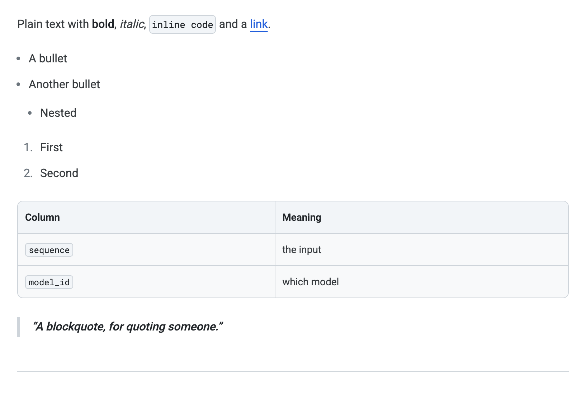

Write a column of numbers as `|---:|`. The values right-align, and every two-column table
marked that way shares one narrow grid, so two of them on a page line up with each other.

## 3. Headings and anchors

Each `##` heading becomes a row in the right-hand table of contents, and gets a link like
`#your-heading-text`. **Renaming a heading changes its link**, so anything pointing at the old
one breaks. If you need a heading whose link never moves, pin it:

```mdx
## A heading with a fixed anchor [#my-anchor]
```


## 4. Code blocks

Three backticks and a language name. The language drives the colours and the little file icon.

````mdx
```python
session = openprotein.connect(username, password)
```
````

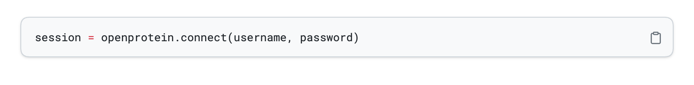

**A filename above the code** – `title="..."`:

````mdx
```python title="fold.py"
result = session.fold.esmfold.fold(sequence)
```
````

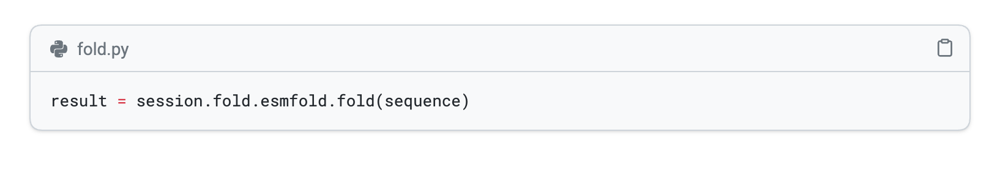

**Point at one line** – put `[!code highlight]` in a comment on it:

````mdx
```python
sequence = "MELKQ"
job = session.fold.esmfold.fold(sequence) # [!code highlight]
pdb = job.wait()
```
````

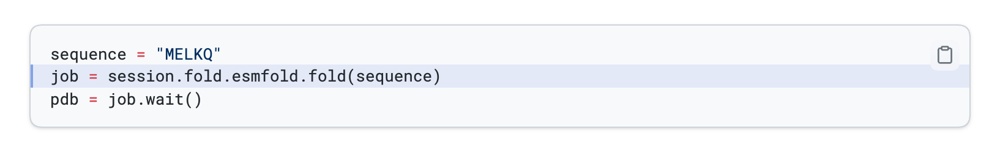

**Point at one word**, everywhere it appears – `[!code word:session]`:

````mdx
```python
job = session.fold.esmfold.fold(sequence) # [!code word:session]
results = session.jobs.get(job.id)
```
````

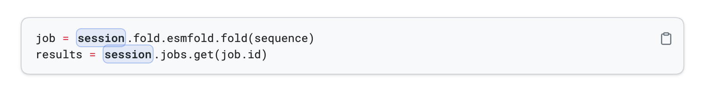

**Show a before and after** – `[!code --]` and `[!code ++]`:

````mdx
```python
job = session.fold.esmfold.fold(seq) # [!code --]
job = session.fold.boltz2.fold(seq) # [!code ++]
pdb = job.wait()
```
````

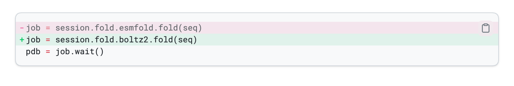

**Numbered lines** – add `lineNumbers`:

````mdx
```python lineNumbers
import openprotein

session = openprotein.connect(username, password)
job = session.fold.esmfold.fold("MELKQ")
```
````

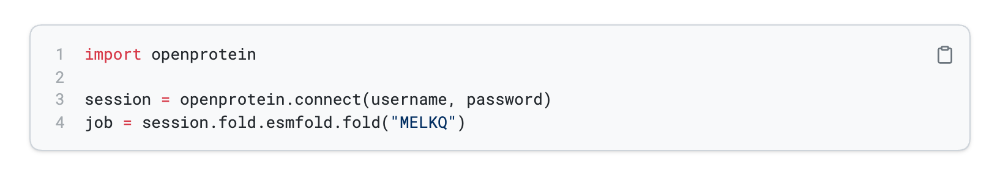

**The same thing in two languages** – give consecutive blocks a `tab="..."` name:

````mdx
```python tab="Python"
session.fold.get_results(job_id)
```

```bash tab="curl"
curl https://api.openprotein.ai/api/v1/fold/$JOB_ID
```
````

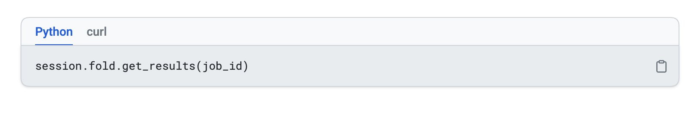

## 5. Components

### 5.1 `<Figure>`

A picture with an optional caption. Readers can click it to zoom. Use this rather than plain
`` so every image on the site behaves the same. Put the file in
`public/_static/<section>/` and link it as `/_static/...`.

Props: `src` (required), `alt`, `caption`, `width`, `align` (`left`, `center`, `right`).

```mdx
<Figure src="/_static/opmodels/align/image1.png" alt="The align screen" caption="Uploading sequences to align" />
```

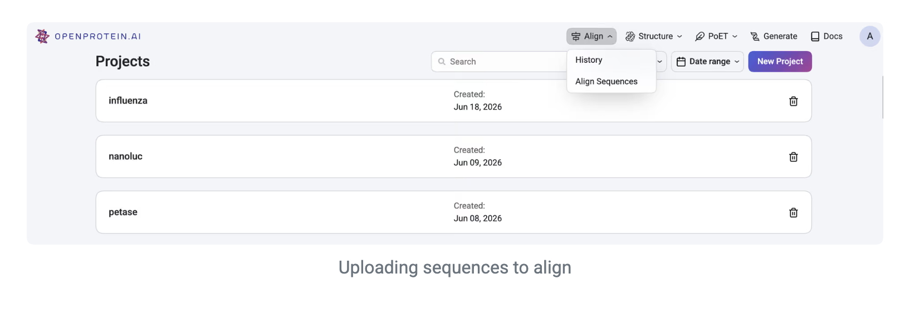

### 5.2 `<Callout>`

A coloured note box. `type` is `info`, `idea`, `warn`, `error` or `success`.

```mdx
<Callout type="info" title="Note">
  Runs are queued and you can close the tab while they finish.
</Callout>

<Callout type="idea" title="Highlights">
  Use a prompt to steer PoET towards the family you care about.
</Callout>

<Callout type="warn" title="Careful">
  Deleting a dataset also deletes every model trained on it.
</Callout>

<Callout type="error" title="Not supported">
  Sequences longer than 2,000 residues are rejected by the folding models.
</Callout>

<Callout type="success" title="Done">
  Your model finished training and is ready to use.
</Callout>
```

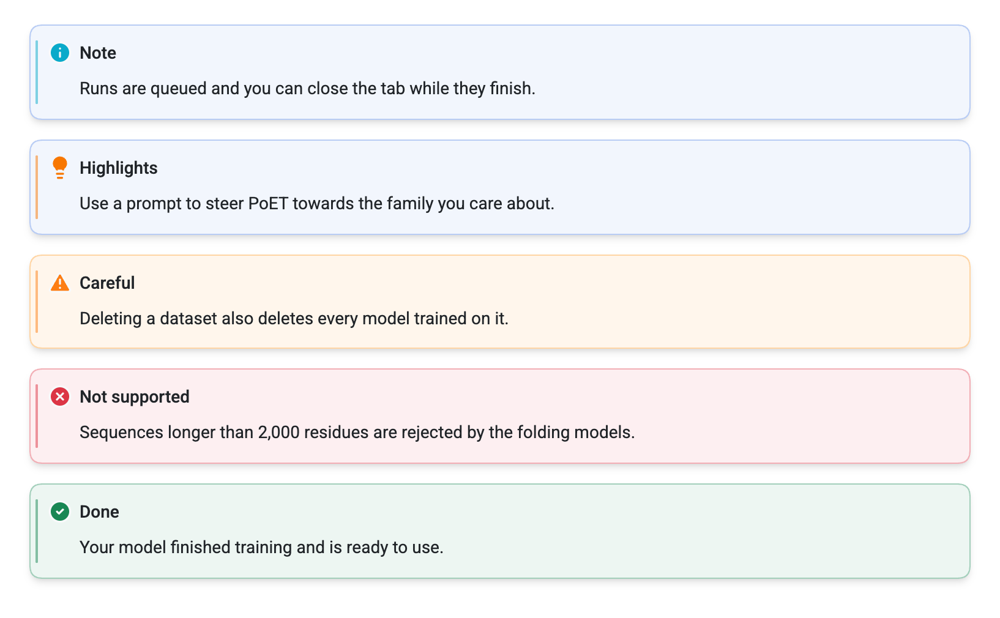

### 5.3 `<Cards>` and `<Card>`

A row of link boxes, usually "where to go next" at the end of a page.

```mdx
<Cards>
  <Card title="via our web app" href="https://app.openprotein.ai" description="Point and click, no code." />
  <Card title="via our Python API" href="/references/python-api" description="Scriptable, for pipelines." />
</Cards>
```

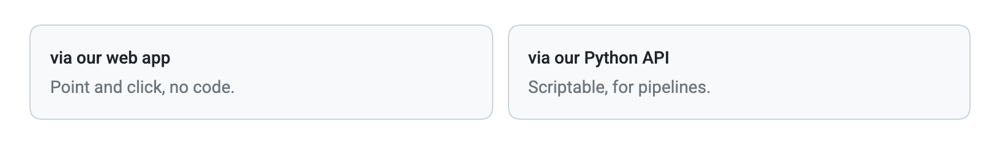

### 5.4 `<Accordions>` and `<Accordion>`

Collapsed sections the reader opens. Good for FAQs and long side-instructions.

```mdx
<Accordions>
  <Accordion title="What are your data security policies?">
    Your data is yours. We never train shared models on it.
  </Accordion>
  <Accordion title="Can I export my results?">
    Yes, every table and plot has a download button.
  </Accordion>
</Accordions>
```

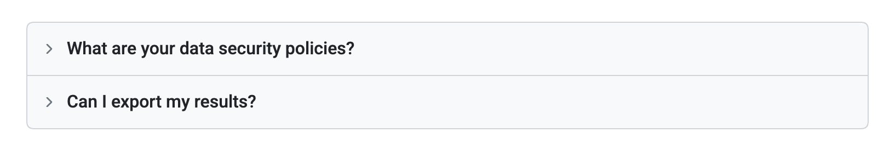

### 5.5 `<Steps>` and `<Step>`

A numbered walkthrough. The `###` inside each step is its title.

```mdx
<Steps>
  <Step>
    ### Upload your data

    A CSV with one sequence per row.
  </Step>
  <Step>
    ### Train a model

    Pick a foundation model and start the run.
  </Step>
</Steps>
```

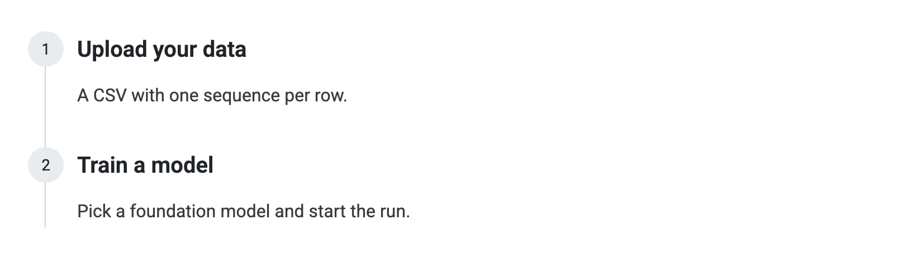

### 5.6 `<Tabs>` and `<Tab>`

One thing shown several ways. Each `value` must match an entry in `items`. For code in two
languages, the `tab="..."` code block above is simpler.

```mdx
<Tabs items={['Python', 'REST']}>
  <Tab value="Python">
    Your content for Tab Python here

    ```python
    session.fold.get_results(job_id)
    ```
  </Tab>
  <Tab value="REST">
    Your content for Tab REST here
    
    ```bash
    curl https://api.openprotein.ai/api/v1/fold/{job_id}
    ```
  </Tab>
</Tabs>
```

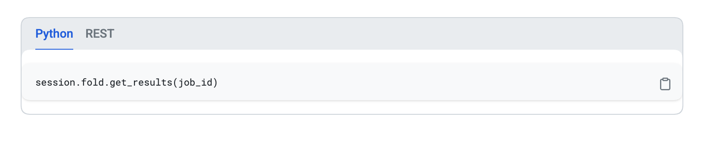

### 5.7 `<TypeTable>`

Parameters and their types. Each row expands to show the description.

```mdx
<TypeTable
  type={{
    sequence: { description: 'The protein sequence to fold.', type: 'string', required: true },
    model_id: { description: 'Which folding model to use.', type: 'string', default: 'esmfold' },
  }}
/>
```

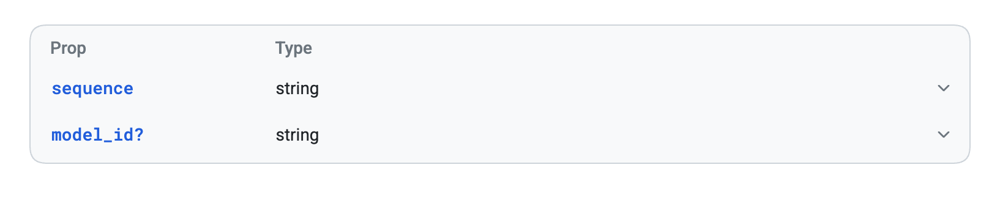

### 5.8 `<Screencast>`

An animated screen recording. Point it at the `.gif`; the site serves a smaller `.webp` when one
has been generated.

```mdx
<Screencast src="/_static/opmodels/uploading-your-data/core-dataset-upload.gif" caption="Uploading a dataset" />
```

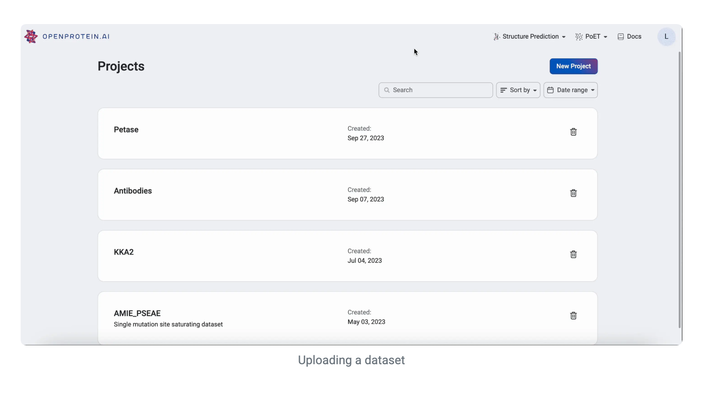

## 6. Components for particular pages

These were built for specific pages. They work anywhere, but check an existing page first.

### 6.1 `<Publications>` and `<Publication>`

The papers list, with the journal's wordmark.

```mdx
<Publications>
  <Publication
    href="https://proceedings.neurips.cc/paper_files/paper/2023/hash/f4366126eba252699b280e8f93c0ab2f-Abstract-Conference.html"
    logo="/_static/resources/neural.png"
    journal="NeurIPS"
    authors="Timothy F. Truong Jr, Tristan Bepler"
    venue="NeurIPS 2023"
  >
    PoET: A generative model of protein families as sequences-of-sequences
  </Publication>
</Publications>
```

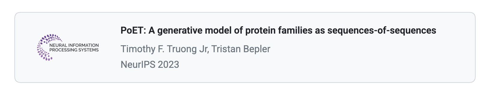

### 6.2 `<Cite>` and `<Bibliography>`

Academic citations. `<Cite id="...">` links to an entry; `<Bibliography>` prints the list at the
bottom of the page. The `id` is the BibTeX key from a file in `content/bib/`.

```mdx
This dataset is from Wrenbeck, Azouz, and Whitehead (<Cite id="Wrenbeck2017-bk" />)
containing activity measurements for enzyme variants.

<Bibliography files={["references.bib"]} />
```

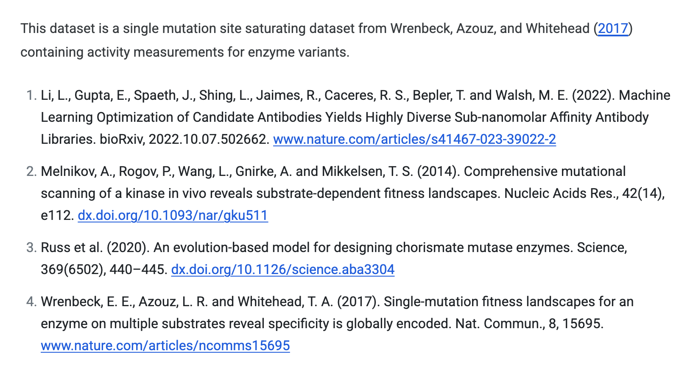

### 6.3 `<SectionCards>`

Cards for every page in a section, built automatically from that section's `meta.json`. Used on
section landing pages.

```mdx
<SectionCards url="/references" />
```

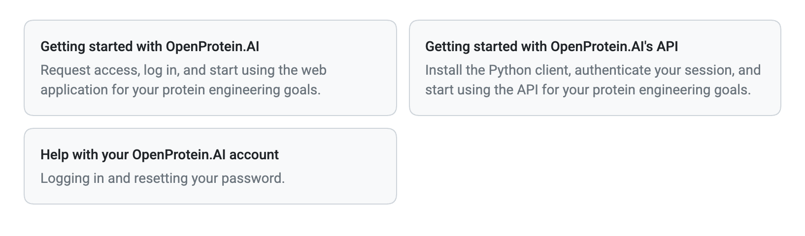

## 7. Math

TeX between dollar signs, drawn by MathJax when the site builds. The page gets SVG and needs no
script.

```mdx
Each position $i$ has a log-likelihood $s_{i,a}$ for every amino acid $a$.

$$
H_i = -\sum_{a=1}^{20} p_{i,a} \log_2 p_{i,a}
$$
```

- `$…$` is inline. `$$` on lines of its own makes a centered display equation, which scrolls
  sideways when it is too wide.
- You get base TeX, the AMS environments and commands (`aligned`, `cases`, `pmatrix`,
  `\operatorname`, `\mathbb`, …) and `\boldsymbol`. `\href`, `\class`, `\style`, `\require` and
  `\unicode` are not available.
- **A TeX error fails the build** and names the equation. The editor's preview shows it in place
  instead, and its **Math** toolbar inserts the common pieces.
- Two dollar signs in one paragraph pair up: `$5 and $10` turns into math. Write `\$` for a
  literal dollar.
- Notebook markdown follows the same rules, except that Jupyter's `$$x$$` inside a sentence is a
  display equation there too.
